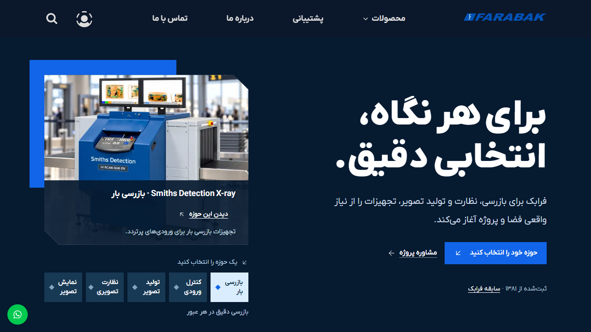
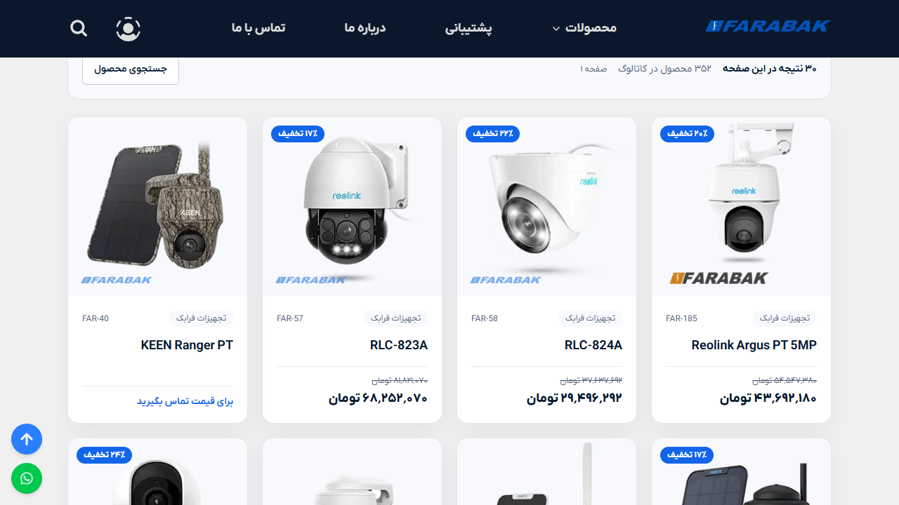
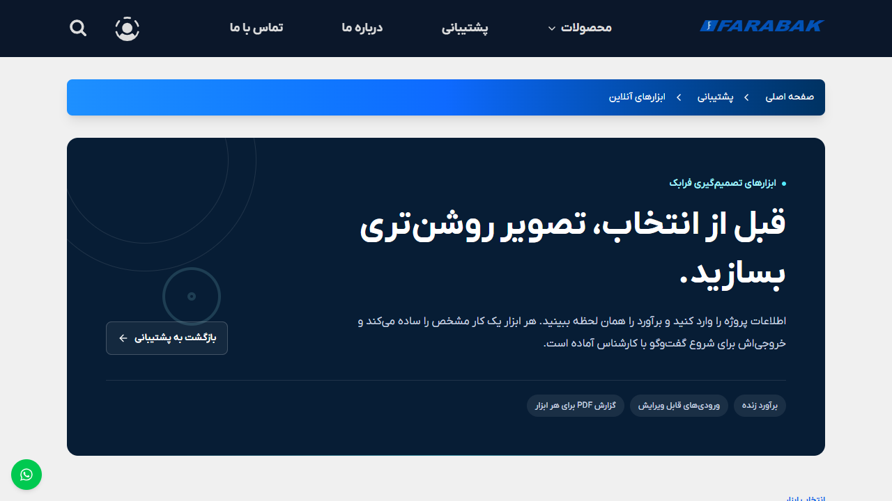

# Farabak Web Platform | فرابک

**The public Farabak website and its connected business tools**

Live project: [farabak.net](https://farabak.net)
This repository contains a Persian-first, right-to-left web platform for product discovery, project planning, customer support, and authenticated business operations.

[Read in English](#english) · [مطالعه به فارسی](#persian)

## Contents

### English

- [Project overview](#en-overview)
- [What the project does](#en-capabilities)
- [How the application works](#en-how-it-works)
- [Technology and implementation](#en-technology)
- [Repository map](#en-repository)
- [Run locally](#en-local)
- [Security and scope](#en-security)
- [Screenshots and evidence](#project-screenshots)

### فارسی

- [معرفی پروژه](#fa-overview)
- [قابلیت‌ها](#fa-capabilities)
- [نحوه کار برنامه](#fa-how-it-works)
- [فناوری‌ها و پیاده‌سازی](#fa-technology)
- [ساختار مخزن](#fa-repository)
- [اجرای محلی](#fa-local)
- [امنیت و محدوده مستندات](#fa-security)
- [تصاویر و شواهد](#project-screenshots)

<a id="project-screenshots"></a>

## Screenshots and evidence | تصاویر و شواهد

The images below were captured from the **live public website** on **14 November 2026**. They show the public interface at the time of capture; catalog information and prices can change. These screenshots document the website UI and do not establish product availability, installation, or project ownership.

تصاویر زیر در **۱۴ نوامبر ۲۰۲۶** از **وب‌سایت عمومی و زنده** ثبت شده‌اند. این تصاویر، رابط عمومی سایت را در زمان ثبت نشان می‌دهند؛ اطلاعات کاتالوگ و قیمت‌ها ممکن است تغییر کنند. تصاویر، نمای رابط سایت هستند و موجودی کالا، نصب محصول یا مالکیت یک پروژه را اثبات نمی‌کنند.

### Live homepage | صفحه اصلی زنده



### Product catalog | کاتالوگ محصولات



### Support planning tools | ابزارهای برنامه‌ریزی پشتیبانی



<a id="english"></a>

## English

<a id="en-overview"></a>

### 1. Project overview

Farabak is a Persian-first product and service platform for security inspection, surveillance, professional imaging, and display equipment. It helps visitors understand solution categories, explore published product information, compare options against a project need, review company and project information, and reach support or sales staff.

The same application also provides authenticated business workspaces for customer, branch, and staff operations. Public visitors use the catalog, articles, company pages, and planning tools; authorized users access operational workflows according to their assigned permissions.

- **Live website:** [https://farabak.net](https://farabak.net)
- **Primary language and layout:** Persian, right-to-left (RTL), with correctly isolated left-to-right model names and codes.
- **Application type:** Full-stack web application with public pages and authenticated operational areas.
- **Primary data store:** PostgreSQL, accessed through Prisma.

<a id="en-capabilities"></a>

### 2. What the project does

#### Product discovery

- Presents the company’s equipment categories, including X-ray inspection, entry screening, CCTV, professional cameras, and LED display systems.
- Provides searchable and paginated catalog browsing, category navigation, product detail pages, specifications, product imagery, related items, and supporting editorial content.
- Offers a guided product advisor. Visitors answer project questions; the advisor compares those answers with information recorded for products and specifications, then presents matching evidence, trade-offs, and unknowns. It can carry a shortlist into a decision board or a report.
- Keeps recommendations appropriately cautious: a missing specification is shown as unknown, and a recommendation is a starting point for review rather than a substitute for a project assessment.

#### Company and project information

- Shares company activity and history, team information, and published project stories.
- Presents editorial guidance to help visitors understand selection factors before choosing equipment.
- Connects relevant articles, categories, products, and consultation options as part of the buyer journey.

#### Support and planning

- Provides help content such as frequently asked questions, software and document downloads, warranty-status lookup, and customer contact options.
- Includes interactive planning tools that calculate or illustrate preliminary project estimates:
  - **CCTV storage planning:** estimates storage, daily data, and bandwidth from camera groups, bitrate, recording hours, retention, motion-recording assumptions, and reserve capacity.
  - **X-ray site-fit review:** compares entered item and site dimensions with published scanner information and flags fit or review considerations.
  - **Meeting-room display planning:** uses room, seating, and viewing-distance inputs to illustrate a preliminary display or projection plan and its assumptions.
- Can produce a downloadable report for support-tool results. Tool output is an estimate based on the entered values and stated assumptions; it is not a final engineering specification.

#### Customer and staff operations

Authenticated areas support customer account and invoice tasks, branch workflows, warranty administration, and staff operations for catalog, pricing, warehouse, and company content. These areas are permission-controlled and are separate from the public product-discovery experience.

<a id="en-how-it-works"></a>

### 3. How the application works

1. **A visitor starts with a need.** The public homepage introduces solution areas and links visitors to relevant product, guidance, support, or consultation content.
2. **The application loads published information.** Server-rendered pages use the application’s data-access layer to load catalog, company, project, and editorial information from the database. Page metadata and structured content are prepared alongside the page content.
3. **Interactive components handle the visitor’s choices.** Search, filters, galleries, guided questions, comparison views, calculators, and forms respond in the browser while retaining the shared Persian RTL layout.
4. **Domain logic turns inputs into useful output.** Product-advisor rules explain which stored facts matched or remain unknown. Support-tool calculation modules validate their inputs, compute estimates, and expose the assumptions behind the result.
5. **Authorized workflows use the same application boundary.** Sign-in and permission checks protect account and staff operations; application services mediate changes to business data.

The application uses Next.js App Router layouts and page-level loading and error states. It combines server-rendered content for discoverability and initial display with client-side React components for interactions that need immediate feedback.

<a id="en-technology"></a>

### 4. Technology and implementation

| Area                 | Implementation                                                                                               |
| -------------------- | ------------------------------------------------------------------------------------------------------------ |
| Web framework        | Next.js 16 App Router                                                                                        |
| UI runtime           | React 19                                                                                                     |
| Language             | TypeScript with strict checking                                                                              |
| Styling              | Tailwind CSS v4, shared public layout components, and responsive RTL patterns                                |
| UI building blocks   | Radix UI, Ant Design in operational screens, and project-specific React components                           |
| Motion               | Motion-based transitions in selected interactive experiences, with reduced-motion behavior where implemented |
| Persistence          | PostgreSQL with Prisma ORM                                                                                   |
| Forms and validation | React form components with schema and field validation                                                       |
| PDF output           | Browser-side report generation for planning-tool results                                                     |
| Quality tooling      | ESLint, Prettier, Vitest, and Cypress tooling                                                                |

Persian is the default reading direction and typography. Local Persian font assets support readable text, while Latin product identifiers are isolated so mixed-language text keeps the correct direction. Public pages also provide page metadata and structured information for search and sharing.

<a id="en-repository"></a>

### 5. Repository map

| Location               | Responsibility                                                                      |
| ---------------------- | ----------------------------------------------------------------------------------- |
| `src/app/`             | App Router pages, layouts, loading and error states, and application UI composition |
| `src/components/`      | Shared UI and reusable application components                                       |
| `src/features/`        | Domain-focused product-advisor and support-tool logic                               |
| `src/lib/data/`        | Database-backed data access and content retrieval                                   |
| `src/content/`         | Curated homepage narratives, proof content, and media metadata                      |
| `prisma/schema.prisma` | Prisma data model for catalog, content, company, and operational records            |
| `public/`              | Static images, fonts, and other public assets                                       |
| `scripts/`             | Project maintenance and content or quality utilities                                |

<a id="en-local"></a>

### 6. Run locally

You need Node.js, pnpm, and private development configuration for the services used by the project. Obtain environment values from the project owner and keep them in an ignored local configuration file; never commit credentials or production values.

```bash
pnpm install
pnpm dev
```

The development command generates the Prisma client before starting the Next.js development server. To create and serve a production build:

```bash
pnpm build
pnpm start
```

Common project checks are available through the package scripts:

```bash
pnpm lint
pnpm test
```

<a id="en-security"></a>

### 7. Security and documentation scope

This README explains the product, user-facing behavior, and high-level implementation. It intentionally does not document API paths, request details, credential names or values, private service configuration, or privileged access instructions. Keep secrets and production configuration outside tracked source files, and grant account access only through the project’s approved access process.

[Back to contents](#contents) · [فارسی](#persian)

<a id="persian"></a>

## فارسی

<a id="fa-overview"></a>

### ۱. معرفی پروژه

فرابک یک پلتفرم فارسی‌محور برای معرفی و انتخاب تجهیزات بازرسی امنیتی، نظارت تصویری، تصویربرداری حرفه‌ای و نمایشگر است. بازدیدکنندگان می‌توانند حوزه‌های راهکار را بشناسند، اطلاعات منتشرشده محصولات را بررسی کنند، گزینه‌ها را با نیاز پروژه خود بسنجند، درباره شرکت و پروژه‌ها بخوانند و با بخش فروش یا پشتیبانی ارتباط بگیرند.

همین برنامه، فضاهای کاری احراز هویت‌شده‌ای نیز برای عملیات مشتریان، شعب و کارکنان دارد. بازدیدکنندگان عمومی از کاتالوگ، مقاله‌ها، صفحات شرکت و ابزارهای برنامه‌ریزی استفاده می‌کنند؛ کاربران مجاز، متناسب با دسترسی تعیین‌شده، به فرایندهای عملیاتی دسترسی دارند.

- **وب‌سایت زنده:** [https://farabak.net](https://farabak.net)
- **زبان و چیدمان اصلی:** فارسی و راست‌به‌چپ، با جداسازی درست نام مدل‌ها و کدهای لاتین.
- **نوع برنامه:** برنامه وب تمام‌پشته با صفحات عمومی و بخش‌های عملیاتی احراز هویت‌شده.
- **ذخیره‌سازی اصلی داده:** PostgreSQL از طریق Prisma.

<a id="fa-capabilities"></a>

### ۲. قابلیت‌های پروژه

#### کشف و انتخاب محصول

- معرفی حوزه‌های تجهیزات از جمله بازرسی ایکس‌ری، کنترل ورودی، دوربین مداربسته، دوربین حرفه‌ای و نمایشگرهای LED.
- جست‌وجو و مرور صفحه‌بندی‌شده کاتالوگ، پیمایش دسته‌ها، صفحه جزئیات محصول، مشخصات، تصاویر، محصولات مرتبط و محتوای راهنما.
- راهنمای انتخاب محصول به‌صورت مرحله‌ای: بازدیدکننده به پرسش‌های پروژه پاسخ می‌دهد و برنامه پاسخ‌ها را با اطلاعات و مشخصات ثبت‌شده محصولات می‌سنجد؛ سپس شواهد تطبیق، ملاحظات و موارد نامشخص را نمایش می‌دهد. گزینه‌ها را می‌توان در میز تصمیم نگه داشت یا به گزارش تبدیل کرد.
- اگر مشخصه‌ای ثبت نشده باشد، نتیجه آن را نامشخص نشان می‌دهد. پیشنهادها نقطه شروع بررسی هستند و جای ارزیابی واقعی پروژه را نمی‌گیرند.

#### معرفی شرکت و پروژه‌ها

- نمایش فعالیت و سابقه شرکت، اطلاعات اعضا و روایت پروژه‌های منتشرشده.
- ارائه مقاله‌ها و راهنماهایی که معیارهای انتخاب تجهیزات را توضیح می‌دهند.
- پیوند میان محتوای آموزشی، دسته‌ها، محصولات و راه‌های دریافت مشاوره در مسیر تصمیم‌گیری مشتری.

#### پشتیبانی و برنامه‌ریزی

- محتوای پشتیبانی شامل پرسش‌های متداول، دریافت نرم‌افزار و اسناد، پیگیری وضعیت گارانتی و راه‌های تماس با کارشناسان.
- ابزارهای تعاملی برای محاسبه یا نمایش برآورد اولیه پروژه:
  - **برآورد ذخیره‌سازی دوربین مداربسته:** بر پایه گروه دوربین‌ها، نرخ بیت، ساعت ضبط، مدت نگهداری، فرض ضبط حرکتی و فضای رزرو، ظرفیت ذخیره‌سازی، داده روزانه و پهنای باند را برآورد می‌کند.
  - **بررسی اولیه تناسب دستگاه ایکس‌ری با محل:** ابعاد واردشده قلم و محل نصب را با اطلاعات منتشرشده دستگاه مقایسه و موارد نیازمند بررسی را مشخص می‌کند.
  - **برنامه‌ریزی نمایشگر اتاق جلسه:** با ابعاد اتاق، تعداد صندلی و فاصله دید، چیدمان مقدماتی نمایشگر یا پروژکتور را نشان می‌دهد و فرض‌های محاسبه را بیان می‌کند.
- امکان تهیه گزارش قابل دریافت از نتایج ابزارها وجود دارد. خروجی بر پایه اطلاعات واردشده و فرض‌های اعلام‌شده است و مشخصات نهایی مهندسی محسوب نمی‌شود.

#### عملیات مشتریان و کارکنان

بخش‌های احراز هویت‌شده از کارهای حساب مشتری و صورتحساب، فرایندهای شعب، مدیریت گارانتی و عملیات کارکنان برای کاتالوگ، قیمت‌گذاری، انبار و محتوای شرکت پشتیبانی می‌کنند. این بخش‌ها بر اساس سطح دسترسی کنترل می‌شوند و از تجربه عمومی انتخاب محصول جدا هستند.

<a id="fa-how-it-works"></a>

### ۳. نحوه کار برنامه

۱. **بازدیدکننده با نیاز خود شروع می‌کند.** صفحه اصلی حوزه‌های راهکار را معرفی می‌کند و مسیر مرتبط با محصول، راهنما، پشتیبانی یا مشاوره را پیشنهاد می‌دهد.
۲. **برنامه اطلاعات منتشرشده را بارگذاری می‌کند.** صفحات سمت سرور از لایه دسترسی داده برای دریافت اطلاعات کاتالوگ، شرکت، پروژه‌ها و مقاله‌ها استفاده می‌کنند. فراداده صفحه و محتوای ساختاریافته نیز همراه صفحه آماده می‌شوند.
۳. **اجزای تعاملی انتخاب‌های کاربر را مدیریت می‌کنند.** جست‌وجو، فیلترها، گالری‌ها، پرسش‌های مرحله‌ای، مقایسه، محاسبه‌گرها و فرم‌ها در مرورگر پاسخ‌گو هستند و چیدمان راست‌به‌چپ برنامه را حفظ می‌کنند.
۴. **منطق دامنه، ورودی را به خروجی کاربردی تبدیل می‌کند.** قواعد راهنمای محصول توضیح می‌دهند کدام مشخصات تطبیق داشته‌اند یا نامشخص‌اند. ماژول‌های محاسباتی ابزارها ورودی را اعتبارسنجی می‌کنند، برآورد می‌سازند و فرض‌های محاسبه را نشان می‌دهند.
۵. **فرایندهای مجاز از مرز امن برنامه استفاده می‌کنند.** ورود و بررسی سطح دسترسی از بخش‌های حساب و کارکنان محافظت می‌کند و سرویس‌های برنامه تغییرات داده‌های کاری را مدیریت می‌کنند.

برنامه از چیدمان‌ها و صفحات App Router در Next.js و وضعیت‌های بارگذاری و خطای اختصاصی هر صفحه استفاده می‌کند. محتوای سمت سرور را برای نمایش اولیه و پیدا شدن در جست‌وجو ترکیب می‌کند و برای تعامل‌های فوری از اجزای React سمت کاربر بهره می‌برد.

<a id="fa-technology"></a>

### ۴. فناوری‌ها و پیاده‌سازی

| حوزه              | پیاده‌سازی                                                                                         |
| ----------------- | -------------------------------------------------------------------------------------------------- |
| چارچوب وب         | Next.js 16 و App Router                                                                            |
| رابط کاربری       | React 19                                                                                           |
| زبان برنامه‌نویسی | TypeScript با بررسی سخت‌گیرانه نوع‌ها                                                              |
| استایل            | Tailwind CSS نسخه ۴، اجزای مشترک چیدمان عمومی و الگوهای واکنش‌گرا برای RTL                         |
| اجزای رابط        | Radix UI، کتابخانه Ant Design در بخش‌های عملیاتی و اجزای اختصاصی React                             |
| حرکت              | گذارهای مبتنی بر Motion در بخش‌های تعاملی منتخب و رعایت حرکت کاهش‌یافته در قسمت‌های پیاده‌سازی‌شده |
| ذخیره‌سازی        | PostgreSQL و Prisma ORM                                                                            |
| فرم و اعتبارسنجی  | اجزای فرم React همراه با اعتبارسنجی فیلد و ساختار داده                                             |
| خروجی PDF         | تولید گزارش نتایج ابزارهای برنامه‌ریزی در مرورگر                                                   |
| ابزارهای کیفیت    | ESLint، Prettier، Vitest و ابزارهای Cypress                                                        |

جهت پیش‌فرض خواندن و تایپوگرافی برنامه فارسی است. فونت‌های فارسی محلی خوانایی متن را حفظ می‌کنند و شناسه‌های لاتین محصولات جدا می‌شوند تا متن ترکیبی جهت درست داشته باشد. صفحات عمومی برای اشتراک‌گذاری و موتورهای جست‌وجو، فراداده و اطلاعات ساختاریافته نیز ارائه می‌کنند.

<a id="fa-repository"></a>

### ۵. ساختار مخزن

| مسیر                   | مسئولیت                                                                  |
| ---------------------- | ------------------------------------------------------------------------ |
| `src/app/`             | صفحات و چیدمان‌های App Router، وضعیت بارگذاری و خطا، و ترکیب رابط برنامه |
| `src/components/`      | اجزای مشترک و قابل استفاده مجدد                                          |
| `src/features/`        | منطق حوزه‌ای راهنمای محصول و ابزارهای پشتیبانی                           |
| `src/lib/data/`        | دسترسی به داده‌های مبتنی بر پایگاه داده و دریافت محتوا                   |
| `src/content/`         | روایت‌های منتخب صفحه اصلی، محتوای اثبات و فراداده رسانه‌ها               |
| `prisma/schema.prisma` | مدل داده Prisma برای کاتالوگ، محتوا، شرکت و سوابق عملیاتی                |
| `public/`              | تصاویر ثابت، فونت‌ها و دیگر فایل‌های عمومی                               |
| `scripts/`             | ابزارهای نگهداری، تولید محتوا و کنترل کیفیت                              |

<a id="fa-local"></a>

### ۶. اجرای محلی

برای اجرا به Node.js، pnpm و تنظیمات خصوصی توسعه برای سرویس‌های مورد استفاده برنامه نیاز دارید. مقادیر محیطی را از مالک پروژه دریافت کنید و در فایل تنظیمات محلیِ نادیده‌گرفته‌شده توسط Git نگه دارید؛ اطلاعات ورود یا مقادیر تولید را commit نکنید.

```bash
pnpm install
pnpm dev
```

دستور توسعه، پیش از اجرای سرور Next.js، Prisma Client را تولید می‌کند. برای ساخت و اجرای نسخه تولید:

```bash
pnpm build
pnpm start
```

دستورهای رایج کنترل پروژه:

```bash
pnpm lint
pnpm test
```

<a id="fa-security"></a>

### ۷. امنیت و محدوده مستندات

این README محصول، رفتار قابل مشاهده برای کاربران و معماری سطح‌بالا را توضیح می‌دهد. مسیرهای API، جزئیات درخواست‌ها، نام یا مقدار اعتبارنامه‌ها، پیکربندی سرویس‌های خصوصی و دستورالعمل دسترسی‌های دارای امتیاز عمداً در آن درج نشده‌اند. اطلاعات محرمانه و پیکربندی تولید را بیرون از فایل‌های تحت نسخه‌بندی نگه دارید و دسترسی حساب‌ها را فقط از فرایند مورد تأیید پروژه اعطا کنید.

[بازگشت به فهرست مطالب](#contents) · [English](#english)
